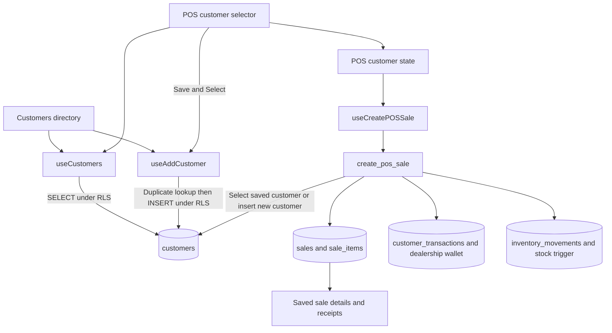

# Customer Module Report

Reviewed: **2026-10-19 (Asia/Dhaka)**.

## 1. Overview

The customer module is a tenant-scoped directory shared with Point of Sale (POS). It supports retail and wholesale customers, search, creation, selection during checkout, and customer references on saved sales and receipts.

It is currently a registration and lookup module. There is no customer profile/detail page, customer editing or deletion, customer-specific purchase history screen, receivables collection screen, or activation workflow.

This report describes the **current working-tree source and ordered migrations**, including existing uncommitted work. Deployment evidence is limited to the release checks listed below. Updated with the sale-tier implementation: switching retail/wholesale reprices the whole draft cart, and each completed sale stores its own tier. The sale-tier migration is applied to the existing Azure backend and the dependent frontend is published to the existing Cloudflare Worker. Production verification passed on 2026-10-19.

## 2. Implementation map

| Area | Source | Responsibility |
| --- | --- | --- |
| Directory | [Customers.tsx](src/pages/Customers.tsx) | Retail/wholesale tabs, search, customer table, Add Customer modal |
| Data access | [useCustomers.ts](src/hooks/useCustomers.ts) | Customer types, queries, search helpers, duplicate check, INSERT, cache invalidation |
| POS selection | [CustomerSelection.tsx](src/components/pos/CustomerSelection.tsx) | Search suggestions, selected-customer card, draft fields, Save and Select |
| Phone rules | [bdPhone.ts](src/lib/bdPhone.ts) | Numeric input normalization, format validation, alternate phone search terms |
| Checkout | [POS.tsx](src/pages/POS.tsx), [usePOS.ts](src/hooks/usePOS.ts) | Customer/cart state and `create_pos_sale` RPC call |
| Price defaults | [POSItemsGrid.tsx](src/components/pos/POSItemsGrid.tsx), [productPricing.ts](src/lib/productPricing.ts) | Retail/wholesale selling prices when adding cart lines |
| Access control | [authorization.ts](src/lib/authorization.ts), [ProtectedRoute.tsx](src/components/ProtectedRoute.tsx), [AuthContext.tsx](src/contexts/AuthContext.tsx) | Route admission, trusted profile, effective capabilities, account cache clearing |
| Dashboard | [useDashboard.ts](src/hooks/useDashboard.ts), [Dashboard.tsx](src/pages/Dashboard.tsx) | Customer count and customer information embedded in sales |
| Receipts | [useReceiptPrinter.ts](src/hooks/useReceiptPrinter.ts) | Reads saved sale/customer information for printing |
| Database | [Baseline](supabase/migrations/20260627000000_cloud_baseline.sql), [authorization migration](supabase/migrations/20261004192158_tenant_permission_authorization.sql) | Tables, keys, relationships, RLS, grants, checkout/accounting |

Related project references: [architecture](docs/architecture.md), [sales and inventory](docs/modules/sales-and-inventory.md), and [tenant authorization](supabase/authorization.md).

## 3. Runtime flow



The React browser communicates directly with Supabase through the shared client. Hooks own the requests; there is no separate customer HTTP service or application backend between the UI and Supabase.

## 4. Customer directory

The directory opens at `#/customers`. It defaults to **Retail Customers** and provides a separate **Wholesale Customers** tab.

The table displays customer name, phone, address and joined date. Wholesale rows also display shop name. Joined dates use the browser's `toLocaleDateString()`. Missing display names become `Unknown`; missing shop/address values display `-`.

Search is shared with POS and queries both tiers. The active tab filters the returned rows in the browser afterward. Switching tabs does not retrieve another page of results.

The page provides loading, failed-load and empty-result messages. It has no pagination, total-result count, explicit retry button, row action, or customer detail navigation. A wide table uses the shared `table-scroll` wrapper; responsive rendering was not exercised during this review.

### Add Customer

1. Open **Add Customer**. The modal starts in retail mode, independently of the directory's active tab.
2. Enter a required phone, optional customer name and optional address.
3. For wholesale, enter a shop name; the modal rejects a blank or whitespace-only shop name.
4. Submit. The hook validates the phone, checks for an exact phone duplicate, and inserts the customer with `profile.tenant_id`.
5. Success invalidates customer queries and closes the modal. The directory keeps its current tab and search, so those filters can hide the newly created row.

An empty customer name is submitted as `Unknown`. Unlike the POS Save and Select path, the directory does not consistently trim name, shop and address before storing them; whitespace-only names can therefore be retained.

The submit button shows `Adding...` and is disabled while saving. Close and Cancel remain available. Errors use an inline message, with a generic fallback when the thrown value is not an `Error` instance.

## 5. Data model and invariants

| Customer field | Repository database definition / behavior |
| --- | --- |
| `tenant_id` | Required UUID; references the business tenant |
| `customer_id` | Required UUID, generated by default |
| `name` | Required `varchar(255)`; the application supplies `Unknown` for an empty directory name or blank checkout name |
| `phone` | Required `varchar(50)` with a database format CHECK |
| `tier` | Nullable `varchar(50)`, default `retail`; UI offers `retail` and `wholesale` |
| `shop_name` | Nullable `varchar(255)` |
| `address` | Nullable text |
| `created_at` | Required timestamp with time zone, default `now()`; added by the [schema correction migration](supabase/migrations/20260627185300_fix_schema_inconsistencies.sql) |

The primary key is **`(tenant_id, customer_id)`**. The unique phone index is **`(tenant_id, phone)`**. Different businesses can store the same phone, and entity UUIDs must be interpreted together with their tenant.

Both `sales` and `customer_transactions` reference customers through composite tenant/customer foreign keys. A customer is a business record, not an Auth user or employee membership.

The reviewed migrations do not constrain `tier` to the two UI values or require a shop name for wholesale records. `name NOT NULL` also does not prevent blank text. These are narrower database guarantees than some forms imply. The directory's exact tier tabs will omit records with null or unsupported tiers.

The shared TypeScript `Customer` interface lives in the hook. It represents `tier` as `string`, while the POS draft restricts its tier to `retail | wholesale`. Customer timestamps are server-generated; authenticated customer INSERT grants exclude `created_at`.

## 6. Phone handling and duplicate identity

The final [phone migration](supabase/migrations/20260702155154_numeric_customer_phone_lengths.sql) and frontend helper accept:

```text
01[3-9][0-9]{8}       Example: 01712345678       11 digits
08801[3-9][0-9]{8}    Example: 08801712345678    14 digits
```

These are the project's implemented formats. A conventional `+880...` value is not directly valid. `normalizePhoneInput()` removes non-ASCII digits rather than converting country prefixes or Bengali numerals. For example, `+8801712345678` becomes `8801712345678`, which still fails validation.

Directory input strips non-digits as the user types. `assertBDMobilePhone()` itself only trims and validates; it does not strip formatting. POS uses a separate candidate extractor for the combined search/phone field.

Search expands a supported local or prefixed number into both representations. For example, searching `01712345678` also searches `08801712345678`.

**Search equivalence does not mean identity equivalence.** Direct creation checks the exact stored phone string, the unique index enforces that exact string, and checkout without a customer ID also checks exact equality. Both example representations can therefore exist as distinct customers in the same tenant. The POS Save and Select visibility check recognizes both representations within its currently loaded search results, but that is not a database deduplication guarantee.

The direct creation duplicate check is a convenience before INSERT, not an atomic reservation. Concurrent attempts with the same exact phone ultimately rely on the unique index. The hook does not inspect the duplicate lookup's error before proceeding; an INSERT failure is still thrown.

## 7. Search behavior and limits

The shared `useCustomers(searchTerm)` pipeline is:

1. Trim, lowercase and split search text on whitespace.
2. Build a server-side OR across every token and the `name`, `shop_name`, `address`, `phone` and `tier` fields, including alternate phone terms.
3. Request rows ordered by name, with a hard **80-row limit**.
4. For a nonempty search, attempt to require every token in a browser filter, rank the survivors, and return at most **50**.
5. For the directory, filter the result by the selected tier.

Phone prefix matches score 50, phone substring matches 35, name/shop prefix matches 25, name/shop substring matches 15, and address matches 8 per token. These branches choose one score per token. No search returns up to the first 80 rows alphabetically. Search requests are keyed by the raw input and have no debounce. Percent signs, underscores and commas are escaped when constructing filter values; this is whitespace token search, not the Purchases module's comma-separated OR-group syntax.

### Confirmed local search defect

`customerMatchesToken()` includes this condition:

```ts
normalizedPhone.includes(normalizePhoneInput(token).toLowerCase())
```

For a token containing no ASCII digits, normalization returns `''`, and every phone includes that empty string. Consequently, the browser's intended all-token filter does **not** enforce alphabetic tokens.

A local probe of the actual extracted helper returned `true` for customer `Rahim` and unrelated token `karim`; an unrelated numeric token returned `false`. With a search such as `Rahim Karim`, a row matching only one word can survive because the server retrieves any-token matches and the browser accepts both alphabetic tokens. The server still applies its OR filter, so this does not mean arbitrary rows are returned for every single-word query.

### Result completeness

Limits run before final ranking and tier filtering. More relevant customers beyond the first 80 server candidates are never ranked. A tier can appear empty even when matching customers exist outside the fetched set. The UI does not disclose truncation, and the POS duplicate visibility check uses these same bounded results.

## 8. POS customer lifecycle

### Selecting an existing customer

The POS search field supports phone, name, shop and address lookup. Suggestions include customer identity, phone, tier and optional address; the dropdown is not filtered by the locally selected tier.

Selecting a suggestion copies the customer and saved ID into POS state, adopts the saved tier, and collapses the form into a compact card. The pencil control is labelled **Choose another customer** and clears the selection. It does not edit the saved record.

Handlers that change customer detail fields remove `customer_id`, `tenant_id` and `created_at`, producing a new draft. The retail/wholesale sale control remains visible for a selected saved customer; changing only the sale tier preserves that customer ID and does not update the customer profile.

### Saving before checkout

For an apparently new valid phone, **Save and Select Customer** is available. It requires a trimmed retail name or wholesale shop name and an address only if supplied. Wholesale saves use the customer name if available, otherwise the shop name. Successful save inserts immediately, shows a toast and selects the record.

This customer persists independently of a later sale. Cancelling checkout or failing checkout does not undo a customer already saved this way.

### Creating during checkout

Saving separately is optional. POS checkout requires a valid phone, a nonempty cart and refill/empty-return parity. It does not require the retail name or wholesale shop name that Save and Select requires.

`useCreatePOSSale()` sends the phone, optional customer ID, draft fields, tier and cart to `create_pos_sale`:

| RPC input situation | Implemented behavior |
| --- | --- |
| Saved `p_customer_id` | Loads that customer using the trusted tenant and ID; fails if absent. Uses saved phone/name, captures the chosen sale tier, and does not update customer details. |
| No ID, exact phone already exists | Rejects checkout and asks the operator to select the saved customer. |
| No ID, exact phone is new | Inserts the customer inside the sale transaction. Trims text, substitutes `Unknown` for a blank name and defaults a null tier to retail. |

The RPC requires `pos:sell` and derives tenant/actor from trusted database helpers. New customer insertion, sale lines, stock movements, customer accounting and wallet changes form one transaction. A later failure rolls back the new customer together with the sale.

The browser validates phone format before the RPC. For newly inserted customers, the table CHECK independently enforces the format. For an existing ID, SQL requires a nonempty supplied phone but loads the saved phone; it does not compare the submitted phone against the saved value.

## 9. Pricing, accounting and downstream reads

**Pricing:** selecting a customer initially adopts that customer's tier. Switching the sale tier, or selecting a customer with another tier, reprices all existing cart lines using the latest active item/tier/refill/package prices. Quantities, discount, exchange fee and notes remain; empty returns stay zero. Missing wholesale prices fall back to retail and missing prices become zero. Price-book refreshes alone do not reprice the cart. Checkout validates submitted prices and totals rather than enforcing a price-book lookup.

**Accounting:** each completed POS sale inserts an `invoice_charge` of negative total and a `payment_receipt` of positive total in `customer_transactions`. Those entries net to zero for that sale, and the dealership wallet increases by the total. This path treats the sale as fully paid; it is not a customer-credit or partial-payment workflow. No customer ledger screen consumes these transactions in the current frontend.

**Dashboard:** `get_dashboard_stats` counts all tenant customers. The UI label is **Active Customers**, but there is no customer activation flag or active/recent filter in that count.

**Saved sales and receipts:** the [sale-tier migration](supabase/migrations/20261019031721_sale_pricing_tier.sql) requires every sale to store `sale_tier` as `retail` or `wholesale`. Checkout captures the chosen tier independently of the saved customer; history, sale details and receipts read this sale-level value. Legacy rows are inferred once from their same-tenant customer, falling back to retail when needed; original historical tier changes cannot be recovered. Name, phone and shop name still come from the related customer row. Apply the migration before deploying the dependent frontend.

## 10. Authorization and tenant isolation

The following rules describe the reviewed authorization migration, not a fresh inspection of deployed policies.

| Operation | Required capability, in addition to active trusted membership and same-tenant scope |
| --- | --- |
| Open Customers route/navigation | `customers:view` or `customers:manage` |
| SELECT customer rows | Any of `customers:view`, `customers:manage`, `pos:sell`, `sales:view`, `receipts:print` |
| Direct customer INSERT | `customers:manage` or `pos:sell` |
| Create a sale | `pos:sell` through the validated RPC |
| SELECT customer transactions | `finance:view` or `finance:manage` |
| Direct customer UPDATE/DELETE | Not granted to the authenticated browser role |

RLS checks the trusted current tenant. Although direct INSERT includes a tenant from the frontend profile, the database policy independently checks that tenant. The customer query does not add its own tenant filter; database RLS is therefore essential.

The seeded OWNER/MANAGER mappings include customer management. SALESMAN has POS access and supporting customer lookup/creation but does not gain the standalone Customers route. Capabilities and trusted mappings, rather than frontend role-name checks, govern access.

The directory's Add Customer control has no separate `customers:manage` check. A custom membership with only `customers:view` can open the directory and see this action, but an INSERT is rejected unless it also has `pos:sell`. This is a UI permission mismatch; it does not establish a database authorization bypass.

## 11. Cache and feedback behavior

- Customer lists use `['customers', 'list', searchTerm]`. The raw search value is included; tenant/user identity is not part of that key.
- App-wide queries have a five-minute stale time and one retry. Customer lists have no polling or realtime subscription.
- Successful direct creation invalidates the `['customers']` prefix. It does not immediately invalidate Dashboard; the Dashboard stats hook polls every 30 seconds.
- Successful checkout invalidates customers, inventory, logistics, movements, sales and Dashboard.
- AuthContext clears the query cache when the Auth user identity changes and after sign-out, mitigating reuse between different signed-in users. A same-user tenant reassignment is not represented in customer query keys and would need deliberate cache handling if supported.
- The directory exposes failed-load feedback. POS reads only customer `data`, with no dedicated customer loading/error/retry state, so a lookup failure can look like missing suggestions and leave new-customer saving unavailable.
- POS marks search text mixing digits and non-digits as a phone error. This can show a phone warning for an otherwise useful lookup such as `Shop 2`; name/address suggestions may still be returned.

## 12. Findings and suggested follow-up

The sale-tier/cart issue has been implemented, deployed and verified. The remaining findings below are analysis results and proposed follow-ups.

| Priority | Finding | Effect / suggested follow-up |
| --- | --- | --- |
| High | Alphabetic token filtering accepts empty normalized phone strings | Locally reproduced helper behavior. Guard empty numeric tokens and cover mixed/multiword searches. |
| High | Fetch limits precede ranking and tier filtering; no pagination | Existing customers can be omitted or a tier can appear empty. Make filtering/completeness explicit and add a way to retrieve further results. |
| Medium | Alternate phone formats are search-equivalent but distinct identities | One real phone can create two records. Agree on canonical identity before changing data or constraints; preserve existing sales/ledger links. |
| Medium | Required fields differ across directory, POS save and checkout; database tier/shop rules are weaker | Customers can be created with `Unknown`, missing wholesale shop names or unsupported tiers through authorized write paths. Define one intentional business contract before changing validation. |
| Medium | POS lookup errors lack dedicated feedback | Operators cannot clearly distinguish failure from no matches. Expose lookup status/retry. |
| Low | Add Customer control ignores the write capability | View-only memberships can reach a form they cannot submit. Gate the action with the same permitted capabilities as creation. |
| Low | Count labelled Active Customers counts every customer | Rename the metric or define and implement an activation/activity rule. |
| Low | Form trimming and error presentation are inconsistent | Whitespace data and generic errors reduce clarity. Normalize optional text and map expected duplicate/validation failures consistently. |

Customer editing, merging duplicates, history, credit collection and export are separate feature gaps, not features implied by the current directory. Any future edit/merge workflow must preserve composite tenant relationships and account for historical receipt display.

## 13. Verification and evidence limits

### Performed for this report

- Read the customer UI/hooks, POS selection/checkout/pricing, auth/cache lifecycle, dashboard/receipt readers, relevant module documentation, and customer-related migrations.
- Ran `npm run auth:test`: **3 passed, 0 failed**. These exercise route capability mapping; they do not test database policies or the customer UI.
- Ran a temporary in-memory source probe using the actual customer search helpers and phone utilities: confirmed the alphabetic-token defect, both accepted numeric formats, alternate search terms, and rejection of `+880...`. This used no network or database and added no test file.
- Checked the report's local Markdown links and reviewed its file diff before handoff.

### Additional sale-tier verification

- Build and focused lint passed. Seven pricing/inventory Node tests passed.
- [Sale-tier browser fixtures](tests/pos-tier.browser.cjs) passed whole-cart repricing in both directions, saved-customer retention, selection of another tier, quantity increases, fallback prices, totals, both checkout tiers, saved details, receipt tier and responsive controls. API/printing were intercepted; no physical receipt was sent.
- Disposable migration replay passed historical tier backfill, [sale-tier SQL](supabase/tests/sale-tier.sql), authorization, receipts, inventory and purchase suites. This uses PGlite PostgreSQL 18.6, not the deployed PostgreSQL server.
- [Authorization SQL](supabase/tests/authorization.sql): tenant fixtures, denied cross-tenant creation, authorized form/customer creation, SALESMAN checkout and receipt readback.
- [Authorization API runner](supabase/tests/authorization-api.mjs): authenticated customer creation, checkout and customer embeds in saved sales.
- [Printing browser fixtures](tests/printing.browser.cjs): customer data in checkout/receipt scenarios, using intercepted API responses.
- No dedicated customer directory/search/phone unit-test suite was found in the reviewed test locations.

### Not verified

Supabase MCP tools were unavailable. Production was verified through the configured SSH target and public API: PostgreSQL 17.6, 21 applied migrations, a required sale-tier column and postgres-owned checkout RPC. Sale-tier, authorization and receipt SQL suites passed on the actual server with rolled-back fixtures. Existing sales (excluding the newly added tier), customers, stock, movements, wallets and customer transactions retained their pre-deployment checksums. The published JavaScript/CSS hashes match the production build, and the published POS passed the browser tier-flow suite with intercepted API/printing fixtures. Backup: `/opt/lpg/backups/deployment-20261019T032933365672Z`. Real Auth/PostgREST end-to-end checkout, physical printing and full-repository lint remain unverified for this release. Browser fixtures verify the shipped UI separately from the production SQL checks.
