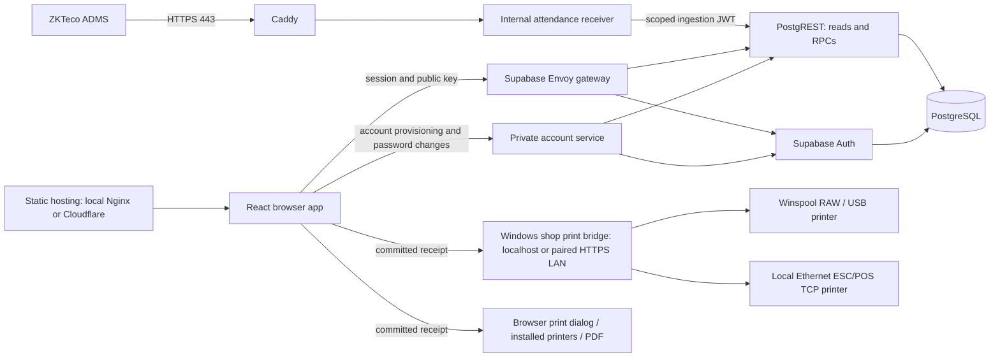

# LPG Manager architecture

Start here before changing a workflow. This map reflects the canonical development model reviewed on **2026-10-31**. The React frontend on the existing Cloudflare Worker uses the primary self-hosted Supabase backend at `144.79.249.4`. The VPS is production infrastructure; the application remains in development. The former Azure deployment is preserved outside the active workflow. Source and ordered migrations are authoritative. Supabase MCP identifies the primary VPS API; read-only MCP inspection and the established SSH/SQL verifier check deployed state.

## Documentation map

| Reference | Read when working on |
| --- | --- |
| [Adaptive layout](modules/adaptive-layout.md) | Card-grid profiles, component audit, display pages, stable record anchors and batch reuse |
| [Sales and inventory](modules/sales-and-inventory.md) | Customer selection, pricing, cylinder balances, checkout and receipt handoff |
| [Purchases and logistics](modules/purchases-and-logistics.md) | Empty-cylinder dispatch, receiving, vehicle/transit state and wallet accounting |
| [Customers](modules/customers.md) | Unified directory filters, monetary totals/dues, Last Sale, selected-product quantities and paging |
| [Dashboard](modules/dashboard.md) | Daily accounting/collection definitions, sold quantities, attention filters and source activity |
| [Finance](modules/finance.md) | Wallet ownership, migration baselines, payment posting, collections and ledger integrity |
| [Employees](modules/employees-and-payroll.md) | Employee profiles, dated salary revisions, fixed monthly salary payments, named bonuses and trip accounting |
| [Attendance](modules/attendance.md) | ADMS receiver, dated business device registrations, effective employee links, separate day/clock-out boundaries, compact daily endpoints, workday summaries, estimated presence and hardware acceptance |
| [Tenant authorization](../supabase/authorization.md) | Trusted membership, capabilities, RLS, RPC gates and grants |
| [Whole-system recovery](../deploy/backup/recovery.md) | Nightly Google Drive backups, encryption/key custody, exact retention and empty-VPS restoration |
| [Deployment internals](../deploy/README.md) | VPS/Cloudflare boundaries, migration approval, backups and recovery |
| [New production VPS](../deploy/production-vps.md) | Verified host security/firewall configuration on `144.79.249.4`, environment isolation and first-deployment prerequisites |
| [Windows printing](../print-bridge/README.md) | Hardware discovery, device identity, RAW transport and job deduplication |
| [Local Compose](../supabase/docker/README.md) / [migration audit](../supabase/migration-audit.md) | Platform dependencies, volume cutover and historical schema reconciliation |

The migration audit is an earlier snapshot; later authorization migrations replace its broad grants, policies and public helpers. Read the authorization guide for those boundaries. Keep specialized guides in their existing locations; update this map and the affected workflow guide when behavior changes. Add a module document only for rules or dependencies that cannot be understood efficiently from the map and source.

## Runtime and dependency boundaries

- The app is a React 19 / TypeScript SPA built by Vite, using React Router's `HashRouter`, TanStack Query, custom CSS, Lucide icons and toast feedback. [App.tsx](../src/App.tsx) composes the query client, Auth provider, layout and route tree. Page modules use module-level `React.lazy` imports; Vite splits their code, shared dependencies and page styles. Suspense around the layout outlet retains navigation during page loading; the outer boundary covers public Auth pages. Providers and the query cache remain above both boundaries. [Route-loading browser checks](../tests/route-loading.browser.cjs) cover cold startup, deferred assets, delayed imports, navigation and direct reloads with API fixtures. Ordinary domain reads/writes still go directly to Supabase. The private `account-service` HTTP boundary handles only privileged GoTrue account provisioning/reset and reauthenticated personal password changes; database preparation/completion independently authorizes the real actor and target.
- [Domain hooks](../src/hooks/) own operational Supabase queries and mutations. Pages and feature components manage forms, cart state and presentation. Shared domain types live in [src/types](../src/types/); customer and POS contracts currently also live in their hooks. [src/lib](../src/lib/) holds phone/currency helpers, capability mappings and receipt clients.
- Visual primitives stay in [index.css](../src/index.css): theme contrast, field boundaries, focus indicators, modal chrome and `.dialog-form` spacing. [surfaces.css](../src/components/ui/surfaces.css) applies shared card edges, section bands and table/form hierarchy while modules retain their compact dimensions. [PurchaseDialog](../src/components/purchases/PurchaseControls.tsx) loads its own styles; collections do not depend on visiting Finance first. Employee, sale, purchase and payment histories reuse the lightweight record surfaces in [history.css](../src/components/ui/history.css). Preserve existing dialog widths, grid tracks, compact controls and body-owned scrolling when extending these patterns.
- [Layout](../src/components/Layout.tsx) provides permission-filtered navigation, the current page title, a permission-gated wallet indicator (Cash Register on Dashboard; combined elsewhere), and the sidebar business/account sign-out menu. On mobile screens, navigation and account controls collapse into an off-canvas drawer toggled from the topbar hamburger menu. The shell contains a scrolling page area. Purchases shows four separated overview figures and compact company/status/date/truck cards with product lists and a single total cost row; complete product/financial details stay in its summary dialog. Its SQL directory filters/searches/sorts before returning cached batches of 25; display pages slice those batches. Shared [control styles](../src/components/ui/controls.css) customize native select pickers where supported and retain native selection, keyboard and validation behavior; other browsers retain styled fields with system menus. [DatePicker](../src/components/ui/DatePicker.tsx) pairs native date typing/validation with a top-layer calendar that also works inside dialogs. Purchase dialogs keep actions visible while their forms scroll.
- PostgreSQL owns multi-table workflows through permission-gated `public` RPCs. Internal recorders and triggers live in unexposed `app_private`. A business RPC and its trigger effects form one database transaction; printing and Auth signup are separate operations.
- Stale purchase, transit, wallet, price, commission and brand-order edits raise the normal `P0001` validation error. They must never raise custom `40001`: PostgREST 14 treats that code as a transient serialization failure and can retry a permanently stale request indefinitely. Migration `20261022181704` preserves the existing guards and replaces only their error codes.
- Shared layout rules in [index.css](../src/index.css) give `.page-content` the dynamic viewport's remaining space and ownership of page scrolling. The viewport declaration in [index.html](../index.html) opts into keyboard-driven content resizing on [supporting Android browsers](https://developer.chrome.com/blog/viewport-resize-behavior/). Pages grow with content; wide tables scroll inside `.table-scroll`, and dialogs scroll their bodies while retaining actions. Workspace container queries adapt multi-panel layouts to the width left by navigation. POS product cards have a maximum width; the desktop checkout sidebar fills the workspace height even when empty and keeps checkout at the bottom. All cart lines render without pagination; tall workspaces scroll the lines while retaining totals, and short workspaces scroll the cart body. Stacked POS layouts provide checkout/products shortcuts. Preserve these boundaries instead of adding page-specific viewport-height calculations.
- [supabase.ts](../src/lib/supabase.ts) builds one browser client from the Vite URL/public key. Development accepts the listed loopback gateways; production also accepts HTTPS self-hosted gateways. Cloud Supabase URLs and privileged secret/service-role keys are rejected. These are build-time settings.
- [compose.yml](../compose.yml) supplies local Nginx, Envoy, Auth, PostgREST, PostgreSQL, Realtime, Storage/imgproxy, Studio/meta, Mailpit, Edge Runtime and Supavisor. [compose.vps.yml](../compose.vps.yml) adds Caddy and production profiles/limits; the updater selects ten backend services, including Studio and postgres-meta. The primary backend is `144.79.249.4`; local Compose remains separate and the former Azure deployment is untouched. The application remains in development on production infrastructure. Studio uses the new API origin with dashboard authentication; see [dashboard access](../deploy/README.md#production-dashboard). [wrangler.json](../wrangler.json) configures a separate static Cloudflare frontend. The bridge runs on a configured Windows shop host outside both stacks: localhost by default or a paired HTTPS LAN endpoint for another device. `src/lib/supabase.ts` scopes browser session storage to the full API host/port, keeping backend cutovers and local environments independent.
- Shared [adaptive grids](modules/adaptive-layout.md) centralize container-based columns and bounded card widths for directories, POS, inventory, selectors and wallets. Measured display pages preserve absolute record anchors across resize, while server batches remain fixed at 25. Product catalogs start each brand on a new row in Settings order; picker pages account for unused row tracks. Comparable directory cards have fixed compact profiles; Sales and Purchases share aligned sections and product-only overflow fades. Directory cards and page/range metadata commit together after required batches load; scope polling invalidates cached batches together. Compact pickers alone use height-based row capacity. Shared [page controls](../src/components/ui/Pagination.tsx) and [list state](../src/hooks/useListPage.ts) bound growing directories, selections, histories and editors. Full collections/drafts still drive summaries, ordering and totals. Customers uses tenant-scoped server aggregates and pages; Dashboard uses a stable server snapshot and separately paged source activity. Customers and Inventory share [InventoryProductPicker](../src/components/inventory/InventoryProductPicker.tsx). Dashboard, Sales, Customers and Inventory share [transaction details](../src/components/transactions/TransactionDetailsModal.tsx); its Print receipt action opens [the receipt-only print modal](../src/components/pos/ReceiptPrintModal.tsx), preserving transaction context without dispatching a job until explicitly printed.
- Android/phone presentation stays in the existing CSS and components. `.mobile-record-table` presents labeled fleet records below 600 CSS pixels while retaining desktop tables. Shared selects use `appearance: base-select` for touch and mouse input, retaining native pickers in unsupported browsers. Android fields follow the compact body text scale; iOS retains 16px fields to prevent focus zoom. Escape dismisses an open picker before its enclosing calendar or receipt dialog. `usePageSize` bounds phone table records without changing full-data totals or draft state. [Android browser checks](../tests/android.browser.cjs) cover every route, secondary tabs, empty data, navigation and forms using isolated API fixtures; [field checks](../tests/field-controls.browser.cjs) cover touch selection, keyboard use and nested pickers.
- Realtime and Storage are platform services, but the current application source has no subscriptions or Storage workflows. The Edge Runtime entrypoint is platform routing/authentication support, not an LPG business API. Refreshes use Query invalidation and polling.

## Module map

| Module | Responsibility and dependencies | Main implementation |
| --- | --- | --- |
| Workspace/authentication | Session, trusted business profile, effective permissions, route/navigation admission | [AuthContext](../src/contexts/AuthContext.tsx), [ProtectedRoute](../src/components/ProtectedRoute.tsx), [authorization.ts](../src/lib/authorization.ts), [Layout](../src/components/Layout.tsx) |
| Dashboard | Server-aggregated daily accounting, collections/counts, LPG weights and stove product-type quantities, money/bottle/stock alerts and permission-filtered activity; printer settings | [Dashboard](../src/pages/Dashboard.tsx), [useDashboard](../src/hooks/useDashboard.ts), [rules](modules/dashboard.md) |
| Customers | Server-paged directory, page-scoped default quantity reads, global overview, unit/activity filtering, validated edits and capability-gated transaction history | [Customer directory hooks](../src/hooks/useCustomerDirectory.ts), [customer components](../src/components/customers/), [shared transaction details](../src/components/transactions/TransactionDetailsModal.tsx) |
| Sales and bottle settlement | Bounded sales directory, original expected products, aggregate physical receipt settlement, independent payments and customer settlement costs; shared transaction details | [Sales](../src/pages/Sales.tsx), [useSales](../src/hooks/useSales.ts), [shared settlement panel](../src/components/transactions/SaleBottles.tsx), [rules](modules/sales-and-inventory.md) |
| POS/customers/inventory | Cart, customer selection, price defaults, stock registry/history and atomic checkout | [POS](../src/pages/POS.tsx), [usePOS](../src/hooks/usePOS.ts), [useCustomers](../src/hooks/useCustomers.ts), [useInventory](../src/hooks/useInventory.ts) |
| Purchases/logistics | Server-paged purchase search, header-only overview, bounded source details, plant/vehicle selection, empty dispatch, receipt, crew snapshots, deferred transit earnings, incurred operating costs, real-wallet settlement, vehicle service trips and staged purchase refunds | [usePurchases](../src/hooks/usePurchases.ts), [useLogistics](../src/hooks/useLogistics.ts), [purchase components](../src/components/purchases/), [logistics components](../src/components/logistics/) |
| Brands/plants/officers | Tenant brand catalog, supplier plants and officer contacts in Settings; supplies inventory/POS/purchase selectors | [useBrands](../src/hooks/useBrands.ts), [useGasPlants](../src/hooks/useGasPlants.ts), [BrandManagement](../src/components/business/BrandManagement.tsx) |
| Employees | Profile/type/phones, salary/status revisions, automatically established salary months, immutable salary/bonus wallet payments, unified activity and Logistics allocations | [Employees](../src/pages/Employees.tsx), [useEmployees](../src/hooks/useEmployees.ts) |
| Attendance | Effective links in employee forms, paginated attendance/corrections, unified daily attendance/employment/payment activity, approved serial-identified direct ADMS and incremental employee workdays; independent of payroll | [useAttendance](../src/hooks/useAttendance.ts), [profile attendance](../src/components/employees/EmployeeAttendance.tsx), [settings](../src/components/business/AttendanceSettings.tsx), [receiver](../attendance-receiver/server.mjs), [rules](modules/attendance.md) |
| Finance | Multi-wallet balances, unified ledger, audited transfers/adjustments, POS receipts and customer collections | [Finance](../src/pages/Finance.tsx), [useFinance](../src/hooks/useFinance.ts), [accounting rules](modules/finance.md) |
| Receipts | Atomically read saved receipt state, share one Unicode formatter/renderer, select browser dialog or local USB/Ethernet transport, test/discover/pair through the bridge | [useReceiptPrinter](../src/hooks/useReceiptPrinter.ts), [receipt](../src/lib/receipt.ts), [printBridge](../src/lib/printBridge.ts), [network transport](../print-bridge/network.ts), [printing](../print-bridge/README.md) |

## Data and transaction model

- Saved sale details and bounded inventory history use `get_sale_details` / `get_inventory_history` to read their source and private actor attribution in one statement snapshot. These RPCs enforce trusted tenancy and the same source-read capabilities; the actor registry remains unexposed. Customer money/bottle dues filters are inclusive, with Both as the intersection and None as the complement.
- Most business identities use `(tenant_id, entity_id)` keys and tenant-qualified relationships. A UUID alone is not a global ownership guarantee. Auth profiles connect real Auth users to one business; RBAC assignments/mappings determine access. Browser capability checks provide navigation, while database RLS, grants and RPC gates enforce authorization independently. See the [authorization guide](../supabase/authorization.md) rather than deriving access from role names or user metadata.
- Direct browser writes are restricted to zero-stock item registration, customer creation and authorized tenant printer upserts. Business mutations derive actor/tenant server-side; purchase RPCs insert referenced stock movements under purchase permission without granting general stock adjustment.
- `items` stores current filled/empty balances, with a business category: LPG requires relational brand/weight identity and stove products require a name and configurable type; names and weight have no duplicate legacy columns. One shared polled inventory query supplies catalog forms, POS and balances. Inserting `inventory_movements` applies deltas through a trigger. Sales couple header/lines, stock, customer transactions, invoice charges, attributed payments and wallet entries. A single ledger trigger applies all wallet balances, including purchase/logistics effects. Tenant-scoped checkout keys serialize matching retries and retain the original response; changed payloads are rejected. The browser retains uncertain POS/purchase-creation requests per tenant/user for recovery. SQL owns active-price and finite-money validation. Each sale captures its own retail/wholesale `sale_tier`; selecting a saved customer reprices the entire cart and locks pricing to that customer type, enforced again by checkout SQL. Draft tier choice is available before customer selection. The sale-tier migration must precede its dependent frontend. Purchases couple stock dispatch/receipt, transits and wallet effects. Dispatch transport is internal transit revenue and never moves wallet money; normal payments and source-backed refund obligations use immutable `purchase_payments`, the existing ledger trigger and Finance request recovery. Received purchases never cancel; OWNER confirmation stops operations before separate refund settlement. Purchase refunds and final transit completion remain independent. Vehicle assignments retain history; transits snapshot crew, expose deferred earnings, and use the existing employee payment/ledger architecture. Gas plants live in Settings. [Sales](modules/sales-and-inventory.md) and [purchases](modules/purchases-and-logistics.md) explain the different timing and accounting coverage.
- Original immutable sale lines define bottle expectations; immutable receipt lines record actual received products. All sales share this model after one-time development normalization. There is no obligation mirror, tracking flag or allocation model. Receipts remain dynamic: `get_sale_receipt` returns original sale quantities/prices/discounts, current tenant/customer/product identity, all bottle receipts and current financial settlement in one statement snapshot. Preview and print use the same loader and `buildSaleReceipt`; no receipt snapshot is stored. Settlement costs reuse receipt `fee`, sale `additional_charges` and the customer ledger. They create no wallet entry until a normal payment is received. Historical expense evidence remains immutable.
- Original sale lines, employee terms, salary months/payments, purchase activity, sale payments and wallet/customer ledger records have UPDATE/DELETE rejection triggers. Inventory history has restricted browser writes. Do not reconstruct balances from transaction sums without checking coverage and historical balances. Audit triggers cover brands and vehicles; purchases also keep an attributed lifecycle/financial history.
- [Migrations](../supabase/migrations/) are an ordered chain: baseline domain DDL, fixes/customer rules, employee and printer additions, reconciliation, then authorization and printer-upsert grants. Later definitions supersede earlier functions/policies. Application SQL depends on Supabase roles, Auth schemas and extensions; it does not install a complete platform. Compose startup/build does not apply arbitrary application migrations to existing data.

## Workspace lifecycle and cache behavior

1. Auth restores/listens for the session. The provider reads the caller's `user_profiles`/tenant identity and calls `get_my_permissions`; profile and permissions refresh every 30 seconds and on query focus.
2. Registration signs up and signs in first, then calls `setup_business`. That RPC locks the Auth identity and atomically creates the tenant, profile, roles, mappings and owner assignment; a second membership is rejected. Signup itself is outside this transaction, so setup failure signs out but does not delete the Auth account.
3. Hooks perform RLS-scoped reads or RPC mutations and invalidate affected query families. Most domain keys are not tenant-keyed; the provider clears the cache when Auth user identity changes and on sign-out. Preserve that behavior when altering workspace admission/caching.
4. The query client defaults to five-minute freshness and one read retry. Dashboard, inventory and purchases add polling. Mutation invalidations must follow cross-module effects, not just the edited screen. There is no offline synchronization layer.
5. [The web manifest](../public/manifest.webmanifest), linked from `index.html`, declares standalone display and stable root identity/start URL/scope. Hash navigation and password sign-in remain within that scope. Vite copies the manifest/icons into `dist`; [the deployment check](../deploy/pwa.mjs) rejects missing assets or changed identity/scope/display before Wrangler publication. There is no service worker or application-shell cache; new launches/reloads use normal network revalidation. Legacy browser shortcuts may require reinstallation as described in [the README](../README.md#installed-android-app).

Dashboard statistics and its eight-sale page use the same Asia/Dhaka day boundary, independent of the browser's timezone. Later customer settlement costs contribute revenue on their receipt date through the existing exchange-charge mechanism. Historical business collection expenses retain their original wallet accounting. Customer count is all tenant customers, and movement count counts rows, not cylinders. The sales feed reads eight completed sales per page plus a look-ahead row since that boundary, and falls back to header-only reads if embeds fail.

## Implemented scope and limits

Operational screens for sales, stock, customers, purchases, vehicles/transits, brands/plants and employees/payments are implemented. Preserve these narrower boundaries:

- Finance provides wallets, ledger filtering and customer dues/collections. Dashboard stock exceptions remain a placeholder.
- Inventory price/commission writes require inventory management capability and trusted OWNER membership. `get_product_inventory` returns the UI's edit-authority flag, current refill/package commission references, selling prices, recorded carrying-value pools and eight weekly aggregates. Commission history is append-only and has no browser read grants. Settings persists brand order; inventory groups by that order, then ascending product weight. Inventory history filters movements before pagination, reuses stock tiles for multi-selection, and opens existing sale/purchase dialogs under their original read permissions. See [sales and inventory](modules/sales-and-inventory.md). Staff invitation/role administration, general reporting and offline operation have no implemented UI/workflow. Employee profiles are not Auth memberships.
- Owner-only valued inventory adjustments reconcile stock, carrying-value pools and balanced journals atomically. Purchase cancellation reverses recorded stock and payments atomically; purchase receipt and custom Return vehicle release the vehicle; final transit completion requires fully paid crew earnings and settles only non-employee costs.
- [attendance-receiver](../attendance-receiver/) is the canonical internal ZKTeco ADMS service; the standalone listener prototype has been removed.
- Receipts support the browser print dialog and direct Windows USB/Ethernet through the existing bridge, packaged with its runtime as a standalone executable. A native silent Windows service starts before login, depends on Spooler, contains its child processes and uses Windows crash recovery. The installer migrates legacy per-user job history to protected ProgramData and preserves settings/journals across updates; the manual launcher starts/restarts the service. USB needs machine-wide queues/fonts visible to SYSTEM. Output preference stays in this browser; printer configuration stays tenant-wide in Supabase. Receipt persistence, API acceptance and physical output are distinct boundaries; see the [printing guide](../print-bridge/README.md).

## Verification entry points

Use [README checks](../README.md#known-limitations-and-checks) for commands and prerequisites. [Route tests](../tests/authorization.test.ts), [SQL authorization tests](../supabase/tests/authorization.sql), [purchase SQL tests](../supabase/tests/purchase-wallets.sql), [receipt/stock SQL tests](../supabase/tests/receipt_printers.sql), bridge tests and deployment tests cover different boundaries. Purchase verification supports rolled-back local SQL and disposable migration replay with before/after migration normalization checks. The API runner creates/cleans fixtures. Inspect targets/effects before execution; fixture tests do not establish deployed schema, real browser/backend integration or physical-device acceptance.

The [Customer directory](modules/customers.md) uses one qualifying-sales dataset for whole-sale monetary totals, current dues, selected-product quantities, activity thresholds and sorting before pagination. Unfiltered name ordering retains bounded page enrichment.

Backend query boundaries, synthetic measurements and remaining growth work are documented in [backend performance](modules/backend-performance.md).

Customer and purchase directories use `useGridPageSize` for three desktop rows based on actual CSS columns, or ten cards on phones. `useBatchedDirectory` separately caches 25-record server batches per filter/sort scope and fetches only missing batches for the displayed range, including direct page jumps. Existing mutation invalidation and active-read refresh apply to batches. Equal grid columns preserve card widths. POS lists and the main Inventory catalog scroll without pagination; Inventory movement history retains bounded server pages with source, product and inclusive Bangladesh date filters.

Bottle tracking preserves original obligations and actual product stock separately. Aggregate settlement remains quantity-based. `20261026035440` permits acknowledged physical over-receipts, clamps each sale's outstanding count at zero, and reuses the existing exchange-charge mechanism for Additional Settlement Cost. Recording a charge creates customer liability; normal partial/split payment collection credits wallets. Original invoices, checkout payments and historical expenses retain their accounting. Preview and printing share one current receipt read, original sale values, all checkout/later bottle receipts and current settlement. The compact collection picker and collapsed checkout controls remain shared. See the Sales and Finance guides for lock order, current contracts and verification boundaries.

Settings uses compact category navigation in [Settings](../src/pages/Settings.tsx). [Business catalogs](../src/hooks/useBusinessSettings.ts) reuse `employee_types` for job titles, independent of RBAC, and tenant `business_weights` for inventory registration. Business creation seeds six job titles, standard weights and midnight attendance. Assigned custom roles/weights can be disabled without rewriting employees or products; referenced entries cannot be removed. [Appearance](../src/hooks/useAppearance.ts) stores each Auth user's theme server-side, with a user-keyed browser fallback. `preferences:manage` admits supported roles to personal Settings, while business controls retain `settings:manage`. Attendance's serial-only identity limitation is explicit in its [module guide](modules/attendance.md).

Custom financial entries use immutable `financial_entries` allocation/category snapshots and Settings `financial_types`; the existing financial request registry and wallet posting trigger remain canonical. Finance and Dashboard share `components/finance/FinancialEntry.tsx`. Vehicle crew uses bounded role-only dropdown reads; vehicle and transit saves require review confirmations.

## Accounting and analytics boundaries

The [accounting guide](modules/financial-analysis.md) is the current map of recognition, opening positions, inventory costing and reconciliation. `accounting_journals` / `accounting_lines` are the single financial source of truth. Source triggers recognize sales, purchases, monthly salary accruals, bonuses and operating costs. A locked private source projection appends corrections; wallet ledger entries settle those same control accounts. `inventory_costs` and immutable `inventory_cost_entries` keep FIFO values consistent with the physical stock ledger, including dispatched empties and customer bottle assets.

`useAccounting` owns report, historical breakdown, reconciliation-health, inventory-adjustment and Finance-management contracts. `Finance/Analysis` presents one paired opening/closing Overview, accumulated income, three charts and server-paged drill-downs. Private monthly savepoints accelerate cumulative positions; source writes atomically invalidate affected cutoffs. Customer lifetime projections update alongside their canonical sources; existing stock/wallet/loan/asset balances are reused. Private pg_cron jobs drain changed-record reconciliation at 03:00 Asia/Dhaka and resume weekly/month-end sweeps. [Accounting](modules/financial-analysis.md) defines cutoff, lock, repair and audit invariants. `AccountingManagement` reuses recoverable Finance requests for loans, assets, opening balances and incurred operating obligations. `finance_obligations` is the shared settlement projection for supplemental opening entries, unpaid business costs and credit-funded assets. It never substitutes for sale, purchase, payroll or loan obligations. All accounting mutation tables are RPC-only with RLS and explicit owner gates where required.

`useVehicleAccounting` retains grouped service/operating costs and their independent cash settlement. Asset book values and disposal are journaled through `business_assets`; vehicle `availability` is independent of journey location/status. New transits reject out-of-service/retired vehicles in SQL. Retirement preserves historical journeys/maintenance/crew and ends current crew assignments. Depreciation is explicitly recorded, without automatic schedules.

The development journal reconstructs available historical sales, invoices, physical movements, payments, contractual salaries and operating costs. Initial stock costs use receipt evidence or labeled consistent test estimates; vehicle estimates and initial capital are explicit, with no arbitrary profit backfill. Empty earlier periods for new businesses report zero. Backdated sources extend history and retain their proper accounting dates. Approximate buying-price overrides remain separate from valuation. Monthly commissions revalue their earned acquisition batches and subsequent FIFO consumption. Valid monthly savepoints plus indexed subsequent journal activity return summarized positions; audit headers and expanded lines have separate bounded RPC pages. Trusted Finance membership and explicit OWNER analysis-sharing grants are checked per request.

Product photos retain the shared `items.image_url` reference and `product-images` Storage bucket. The reference stores a tenant-prefixed object path, validated against Storage; the bucket is private. `useProductImages.ts` owns uploads, cached signed reads and replacement/removal. Uploads normalize to bounded WebP rasters before Storage; server policies enforce trusted tenancy, capabilities, MIME types and size limits. Catalogs, POS, purchases and sales reuse `ProductImage`.
### FIFO and monthly LPG commissions

The canonical implementation is migration `20261031221903_monthly_commission_fifo.sql`. Private FIFO acquisition layers and consumption links maintain current cost pools; journals and month-end savepoints supply historical reports. `useMonthlyCommissions` and the LPG costing panel manage protected Package/Refill monthly pairs and attribution/history. The inventory RPC projects one active pair into both the displayed rates and approximate buying prices; restore-automatic uses that same private reference. Historical FIFO continues to use exact receipt-month rates. Purchases record actual receipt dates and earned-month deductions independently of their own gross acquisition costs. `PurchaseCommission` provides owner corrections through the same purchase audit and recovery conventions. Filled packages include their shell; package sales no longer consume a separate empty shell. FIFO refill shell costs move through transit and bottle receivables exactly once.

Finance navigation is Analysis, Wallet Ledger and Loans. `BalanceAdjustments` integrates opening cash, owner investments, corrections and existing asset/obligation registers without duplicating histories. Customer dues predicates run before directory pagination and use current monetary/bottle balances independently of activity-date filters.

## Financial dimensions

`financial_types` defines system/custom operation identity; fixed `accounting_accounts` determine recognition. Every `accounting_lines` row has type, business and original journal source, with a separate consolidated amount for internal transport eliminations. `wallet_transactions` is the only cash ledger; `wallets.business_balances` projects three signed portions atomically. Custom source records live in `financial_entries`, and asset/loan/obligation/payroll sources retain ownership allocations. Existing FIFO layers/consumptions also carry internal transport overhead; no second inventory issue algorithm is used.

The current contract is [Financial operation matrix](modules/financial-type-matrix.md). UI configuration is `FinancialTypes`, shared allocation controls use `BusinessAllocation`, and catalog data remains in `useFinancialTypes`. Reports and typed month-end savepoints share the canonical journal. Source history links preserve each original module's authorization.

The Finance type catalog exposes exactly Withdrawal, Expense, Capital, Revenue and Equipment; journal accounts remain internal accounting detail. Financial Entries owns source-entry browsing and actual-return links. Reports derive one trusted organization and offer only business-line scope. Monthly commissions retain one effective Package/Refill pair, with invoice-price inference and immutable custom override history. Inventory has separate LPG pricing/commission and Stove identity/pricing/unit-activity presentations.

## Platform and business access

`#/admin` is a separately guarded platform workspace; `#/users` is OWNER account/access management. `AuthContext` uses `get_access_context` for verified session, status, workspace and capability state. Business selection lives in a private Auth-session record, while business actor foreign keys use `tenant_actors` so platform writes retain the real administrator without a fabricated membership. OWNER always has every capability; staff role defaults may be replaced by validated individual allowlists. Public signup and `setup_business` are removed. [Authorization](../supabase/authorization.md) owns the detailed session/RLS/RPC, password, Storage and audit contracts.

## Centralized disaster recovery

`deploy/backup` owns pgBackRest physical cluster backups/local WAL, sealed Storage/configuration captures, Restic encryption/deduplication and nightly rclone transfers. A shared deployment lock and a short archive lock separate live writes from immutable captures. Cloud snapshots retain their complete dependencies for 30 daily days and 12 explicitly tagged monthly full points. The root-owned Unix controller independently enforces current superadmin Auth/session checks behind the existing private account service. `useBackups` owns the frontend contract; `BackupManagement` renders cached statistics and schedules/queues operations without daytime Drive polling. Web OAuth uses a fixed HTTPS callback and backend-only refresh tokens. Monthly drills restore into new internal-network containers with empty temporary PGDATA, disabled cron and no public ports. Recovery secrets are excluded from captures and exported separately. See the [recovery procedure](../deploy/backup/recovery.md).
