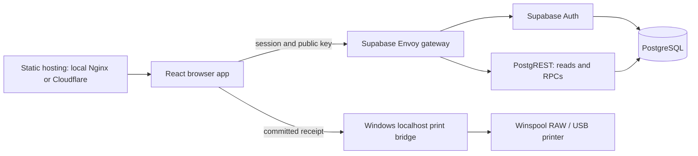

# LPG Manager architecture

Start here before changing a workflow. These documents describe the repository implementation reviewed on **2026-10-15**. The purchase lifecycle and refill exchange migration are deployed to the existing Azure backend and Cloudflare Worker. Source and ordered SQL migrations are authoritative. Purchase deployment was verified against VPS PostgreSQL 17.6 and real Auth/PostgREST with isolated fixture businesses and concurrent sessions. Full modal/browser scenarios use API fixtures; physical printing is a separate acceptance boundary. Supabase MCP tools were unavailable during this verification.

## Documentation map

| Reference | Read when working on |
| --- | --- |
| [Sales and inventory](modules/sales-and-inventory.md) | Customer selection, pricing, cylinder balances, checkout and receipt handoff |
| [Purchases and logistics](modules/purchases-and-logistics.md) | Empty-cylinder dispatch, receiving, truck/transit state and wallet accounting |
| [Employees and payroll](modules/employees-and-payroll.md) | Phone ownership, payment constraints and employee lifecycle |
| [Tenant authorization](../supabase/authorization.md) | Trusted membership, capabilities, RLS, RPC gates and grants |
| [Operations](../OPERATIONS.md) | Commands, environments, builds, tests and deployments |
| [Deployment internals](../deploy/README.md) | Azure/Cloudflare boundaries, migration approval, backups and recovery |
| [Windows printing](../print-bridge/README.md) | Hardware discovery, device identity, RAW transport and job deduplication |
| [Local Compose](../supabase/docker/README.md) / [migration audit](../supabase/migration-audit.md) | Platform dependencies, volume cutover and historical schema reconciliation |

The migration audit is an earlier snapshot; later authorization migrations replace its broad grants, policies and public helpers. Read the authorization guide for those boundaries. Keep specialized guides in their existing locations; update this map and the affected workflow guide when behavior changes. Add a module document only for rules or dependencies that cannot be understood efficiently from the map and source.

## Runtime and dependency boundaries

- The app is a React 19 / TypeScript SPA built by Vite, using React Router's `HashRouter`, TanStack Query, custom CSS, Lucide icons and toast feedback. [App.tsx](../src/App.tsx) composes the query client, Auth provider, layout and route tree. There is no application HTTP backend between the browser and Supabase.
- [Domain hooks](../src/hooks/) own operational Supabase queries and mutations. Pages and feature components manage forms, cart state and presentation. Shared domain types live in [src/types](../src/types/); employee, customer and POS contracts currently also live in their hooks. [src/lib](../src/lib/) holds phone/currency helpers, capability mappings and receipt clients.
- [Layout](../src/components/Layout.tsx) provides permission-filtered navigation, the current page title, theme control, a permission-gated dealership wallet, and the sidebar business/account sign-out menu. On mobile screens, navigation and account controls collapse into an off-canvas drawer toggled from the topbar hamburger menu. The shell contains a scrolling page area. Purchases shows four separated overview figures and compact company/status/date/truck cards with product lists and a single total cost row; complete product/financial details stay in its summary dialog. Its toolbar filters/searches the existing query result before sorting. Shared [control styles](../src/components/ui/controls.css) customize native select pickers where supported and retain native selection, keyboard and validation behavior; other browsers retain styled fields with system menus. [DatePicker](../src/components/ui/DatePicker.tsx) pairs native date typing/validation with a top-layer calendar that also works inside dialogs. Purchase dialogs keep actions visible while their forms scroll.
- PostgreSQL owns multi-table workflows through permission-gated `public` RPCs. Internal recorders and triggers live in unexposed `app_private`. A business RPC and its trigger effects form one database transaction; printing and Auth signup are separate operations.
- [supabase.ts](../src/lib/supabase.ts) builds one browser client from the Vite URL/public key. Development accepts the listed loopback gateways; production also accepts HTTPS self-hosted gateways. Cloud Supabase URLs and privileged secret/service-role keys are rejected. These are build-time settings.
- [compose.yml](../compose.yml) supplies local Nginx, Envoy, Auth, PostgREST, PostgreSQL, Realtime, Storage/imgproxy, Studio/meta, Mailpit, Edge Runtime and Supavisor. [compose.azure.yml](../compose.azure.yml) adds Caddy and production profiles/limits; the updater selects ten backend services, including Studio and postgres-meta. Production Studio uses the API origin with dashboard authentication; see [dashboard access](../deploy/README.md#production-dashboard). [wrangler.json](../wrangler.json) configures a separate static Cloudflare frontend. The bridge runs on the browser's Windows host, outside both stacks.
- Realtime and Storage are platform services, but the current application source has no subscriptions or Storage workflows. The Edge Runtime entrypoint is platform routing/authentication support, not an LPG business API. Refreshes use Query invalidation and polling.

## Module map

| Module | Responsibility and dependencies | Main implementation |
| --- | --- | --- |
| Workspace/authentication | Session, trusted business profile, effective permissions, route/navigation admission | [AuthContext](../src/contexts/AuthContext.tsx), [ProtectedRoute](../src/components/ProtectedRoute.tsx), [authorization.ts](../src/lib/authorization.ts), [Layout](../src/components/Layout.tsx) |
| Dashboard | Daily completed-sale feed and aggregate revenue/movement/customer counts; printer settings entry point | [Dashboard](../src/pages/Dashboard.tsx), [useDashboard](../src/hooks/useDashboard.ts), [dashboard components](../src/components/dashboard/) |
| POS/customers/inventory | Cart, customer selection, price defaults, stock registry/history and atomic checkout | [POS](../src/pages/POS.tsx), [usePOS](../src/hooks/usePOS.ts), [useCustomers](../src/hooks/useCustomers.ts), [useInventory](../src/hooks/useInventory.ts) |
| Purchases/logistics | Plant/truck selection, empty dispatch, receipt, transits, costs and two wallets | [usePurchases](../src/hooks/usePurchases.ts), [useLogistics](../src/hooks/useLogistics.ts), [purchase components](../src/components/purchases/), [logistics components](../src/components/logistics/) |
| Brands/plants/officers | Tenant brand catalog, supplier plants and officer contacts; supplies inventory/POS/purchase selectors | [useBrands](../src/hooks/useBrands.ts), [useGasPlants](../src/hooks/useGasPlants.ts), [BrandManagement](../src/components/business/BrandManagement.tsx) |
| Employees/payroll | Profiles, employee types/phones and immutable categorized payment history | [Employees](../src/pages/Employees.tsx), [useEmployees](../src/hooks/useEmployees.ts) |
| Receipts | Read saved sales and latest tenant settings, build receipt content, request host printing | [useReceiptPrinter](../src/hooks/useReceiptPrinter.ts), [completeSale](../src/lib/completeSale.ts), [printBridge](../src/lib/printBridge.ts), [print-bridge](../print-bridge/) |

## Data and transaction model

- Most business identities use `(tenant_id, entity_id)` keys and tenant-qualified relationships. A UUID alone is not a global ownership guarantee. Auth profiles connect real Auth users to one business; RBAC assignments/mappings determine access. Browser capability checks provide navigation, while database RLS, grants and RPC gates enforce authorization independently. See the [authorization guide](../supabase/authorization.md) rather than deriving access from role names or user metadata.
- Direct browser writes are restricted to zero-stock item registration, customer creation and authorized tenant printer upserts. Business mutations derive actor/tenant server-side; purchase RPCs insert referenced stock movements under purchase permission without granting general stock adjustment.
- `items` stores current filled/empty balances. Inserting `inventory_movements` applies deltas through a trigger. Sales couple header/lines, stock, customer transactions and dealership balance; purchases couple stock dispatch/receipt, transits and wallet effects. [Sales](modules/sales-and-inventory.md) and [purchases](modules/purchases-and-logistics.md) explain the different timing and accounting coverage.
- Employee payment and purchase activity records have explicit UPDATE/DELETE rejection triggers. Inventory and wallet/customer ledgers have restricted browser writes but do not share that immutability mechanism. Do not reconstruct balances from transaction sums without checking coverage and historical balances. Audit triggers cover brands and trucks; purchases also keep an attributed lifecycle/financial history.
- [Migrations](../supabase/migrations/) are an ordered chain: baseline domain DDL, fixes/customer rules, employee and printer additions, reconciliation, then authorization and printer-upsert grants. Later definitions supersede earlier functions/policies. Application SQL depends on Supabase roles, Auth schemas and extensions; it does not install a complete platform. Compose startup/build does not apply arbitrary application migrations to existing data.

## Workspace lifecycle and cache behavior

1. Auth restores/listens for the session. The provider reads the caller's `user_profiles`/tenant identity and calls `get_my_permissions`; profile and permissions refresh every 30 seconds and on query focus.
2. Registration signs up and signs in first, then calls `setup_business`. That RPC locks the Auth identity and atomically creates the tenant, profile, roles, mappings and owner assignment; a second membership is rejected. Signup itself is outside this transaction, so setup failure signs out but does not delete the Auth account.
3. Hooks perform RLS-scoped reads or RPC mutations and invalidate affected query families. Most domain keys are not tenant-keyed; the provider clears the cache when Auth user identity changes and on sign-out. Preserve that behavior when altering workspace admission/caching.
4. The query client defaults to five-minute freshness and one read retry. Dashboard, inventory and purchases add polling. Mutation invalidations must follow cross-module effects, not just the edited screen. There is no offline synchronization layer.

Dashboard's day boundary comes from the browser's local `startOfDay`, passed as UTC ISO to SQL; there is no fixed Bangladesh timezone calculation. Customer count is all tenant customers, and movement count counts rows, not cylinders. The sales feed limits to 50 completed sales since that boundary and falls back to header-only reads if embeds fail.

## Implemented scope and limits

Operational screens for sales, stock, customers, purchases, trucks/transits, brands/plants and employees/payments are implemented. Preserve these narrower boundaries:

- Finance is a placeholder route despite wallet/customer ledger tables and accounting effects. Business profile editing and Dashboard stock exceptions are placeholders.
- Price-book reads exist; price maintenance, staff invitation/role administration, reporting and offline operation have no implemented UI/workflow. Employee profiles are not Auth memberships.
- Manual inventory adjustment has a hook/RPC but no exposed adjustment dialog. Purchase status includes `cancelled`, but there is no purchase cancellation/reversal RPC in the migration chain.
- [zk-test/test.cjs](../zk-test/test.cjs) is a standalone ZKTeco ADMS listener prototype. It acknowledges/logs attendance pushes without persistence or employee/payroll integration.
- Printing is Windows USB only with manual bridge startup. Receipt persistence, local job acceptance and physical output are distinct boundaries; hardware/origin requirements and uncertainty handling belong to the [printing guide](../print-bridge/README.md).

## Verification entry points

Use [Operations: checks and tests](../OPERATIONS.md#10-checks-and-tests) for commands and prerequisites. [Route tests](../tests/authorization.test.ts), [SQL authorization tests](../supabase/tests/authorization.sql), [purchase SQL tests](../supabase/tests/purchases.sql), [receipt/stock SQL tests](../supabase/tests/receipt_printers.sql), bridge tests and deployment tests cover different boundaries. Purchase verification supports rolled-back local SQL and disposable migration replay with historical compatibility. The API runner creates/cleans fixtures. Inspect targets/effects before execution; fixture tests do not establish deployed schema, real browser/backend integration or physical-device acceptance.
