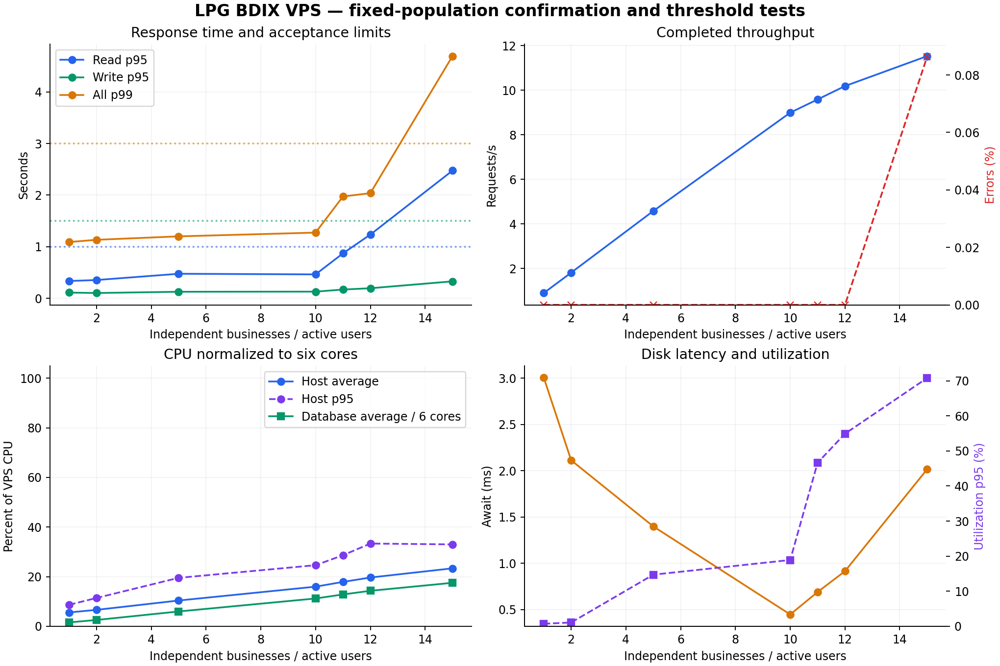
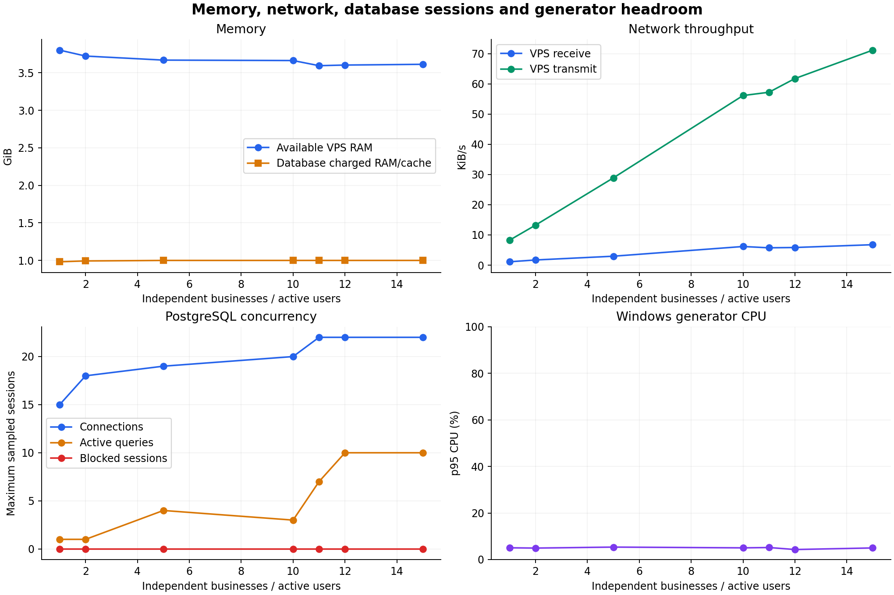
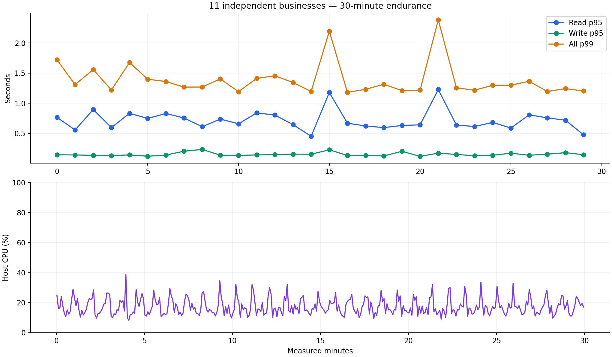

# LPG BDIX VPS concurrent-business capacity — 29 October 2026

Measured comfortable capacity: **10** active businesses. Highest confirmed endurance concurrency: **11**. First failing requested stage: **15**; fine-test failure bound: **12**. Each business has its own authenticated user, 2,000 customers and at least 20,000 historical invoices. These numbers apply to the tested workload and current deployment configuration.

## Target and method

The existing primary development backend at `144.79.249.4` was tested through its public Caddy/Envoy HTTPS API, Auth and PostgREST. Azure was not contacted. Windows generated all measured load and hosted k6 2.3.0, Grafana 13.3.0 and Prometheus 3.15.1. The VPS only hosted a five-second read-only sampler.

The server exposes six KVM vCPUs (Xeon E5-2695 v4, 2.10 GHz) and about 5.6 GiB RAM. Its actual virtual disk is **100 GiB**, with a roughly 99 GiB root filesystem, rather than the requested 150 GB. Existing PostgreSQL 17.6 retains its **1 GiB container limit**, 256 MiB shared buffers, 4 MiB work memory and 80 maximum connections. Existing PostgREST retains **ten pooled connections**. No optimization or service configuration change was made. All 39 migration versions and deployed source checksums were verified, with none pending.

Each stage has 60 seconds warmup and five measured minutes, normal 1.5–2.5 second interaction delays, additional cart/payment review time, normal page fan-out, bounded draining and cooldown. The mixed cycle covers POS cash/split sales and collections, customer pages/search/reporting, stock and history, purchases with dispatch/receipt/payment, Finance ledger/dues/transfers, Dashboard and saved receipts. Every k6 VU owns a different business. Sessions refresh outside measurement windows. Preparation, analysis and reconciliation are excluded.

The requested discovery sequence is followed exactly. Additional tenants are fully seeded before the next discovery stage. Confirmation and fine tests keep the final stored population fixed. Legitimate measured writes accumulate; stored population and original history remain fixed, rather than restoring transactions between stages. Latency includes response failures and drain. Throughput counts completions inside the measured window. Minute-level tails, endpoint statistics and all resource aggregates are in the evidence JSON.

## Experiment controls and excluded attempts

Initial `discovery-*` rows used the first script, whose optional checkout-replay condition never fired. The corrected script hash is `d2133bac2af5ff614741929c32c4bcd28dbeb3f074400c579eb64b84446e45f7`; `fixed-1`, `confirm-*`, fine and endurance runs used it. Final curves select the latest corrected run per concurrency at the fixed 15-business population. Initial discovery remains visible as preliminary evidence.

A Windows/network interruption stopped session preparation before a new measured stage. The monitoring SSH stream also reset. Initial ping was 3–6 ms and the Wi-Fi adapter reported 585 Mbps; the recovered path had higher latency and a 144.4 Mbps link rate. Public HTTPS/Auth/Realtime and server health were rechecked; the corrected confirmation sequence restarted at one user. An additional ten-second warmup was excluded when a safety guard mistook a normal Realtime WAL sender for a long client query. The guard now excludes replication streams. A local-only k6 REST shutdown control verified summary preservation without VPS traffic. None of these excluded attempts are capacity failures.

Resources are five-second samples. Later samples map collection time to the Windows receive clock, retaining original server timestamps; earlier correlation has approximately one sampling interval of clock uncertainty. No seeding or correctness queries run inside measured windows.

## Dataset and correctness

Each fixture contains 20,000 historical invoices over 180 days, 200 related purchase shipments, six SKUs, 2,000 customers, attributed cash/bank payments, subsequent collections, customer charges, physical empty receipts and stock movements. One quarter of invoices remain unpaid. Generation calls existing authenticated domain RPCs with RBAC, constraints and posting triggers enabled. Private hooks date only registered fixture inserts during preparation and are removed before load. Synthetic opening capital is documented; it is not real operator money.

Every stage checks wallet and running ledger balances, sale/payment/customer attribution, purchase funding, invoice totals, dues, stock/movement and bottle reconciliation. Authenticated foreign-tenant direct and RPC probes verify isolation. Existing business tables are fingerprinted separately. Full check results, sample counts and preservation evidence are retained.

## Criteria and safety

Pass: read p95 ≤1 s, write p95 ≤1.5 s, overall p99 ≤3 s, unexpected errors <0.5%, zero correctness failures. Comfortable: read p95 ≤0.5 s, write p95 ≤0.75 s, no observed errors, host CPU p95 <70%. The highest passing concurrency is tested for 30 measured minutes after warmup.

Automatic stops protect memory/disk reserves, swap, OOM, sustained >95% host CPU, blocked/long queries, Windows generator resources and stale monitoring. Severe error/latency thresholds also abort k6. Exact values and reproduction commands are in the [suite guide](../../supabase/tests/vps-capacity/README.md).

## All measured stages

HTTP times are milliseconds. RPS counts successful completed requests inside the window; errors include unsuccessful responses, not only successful latency. Discovery rows have changing stored populations; fixed/fine/endurance rows share the final population.

| Stage | Users | Stored businesses | Minutes | Requests | OK/s | Mean | All p95 | Read p95 | Write p95 | All p99 | Errors | Pass |
|---|---:|---:|---:|---:|---:|---:|---:|---:|---:|---:|---:|:---:|
| discovery-1 | 1 | 5 | 5.0 | 290 | 0.97 | 65 | 180 | 198 | 38 | 1058 | 0.00% | yes |
| discovery-2 | 2 | 5 | 5.0 | 582 | 1.94 | 66 | 188 | 209 | 37 | 1097 | 0.00% | yes |
| discovery-5 | 5 | 5 | 5.0 | 1,435 | 4.77 | 76 | 238 | 254 | 60 | 1158 | 0.00% | yes |
| discovery-10 | 10 | 10 | 5.0 | 2,830 | 9.43 | 90 | 320 | 337 | 71 | 1101 | 0.00% | yes |
| discovery-15 | 15 | 15 | 5.0 | 3,612 | 12.02 | 326 | 1813 | 1995 | 234 | 3781 | 0.00% | no |
| fixed-1 | 1 | 15 | 5.0 | 289 | 0.96 | 75 | 252 | 259 | 58 | 1037 | 0.00% | yes |
| confirm-1 | 1 | 15 | 5.0 | 274 | 0.90 | 144 | 331 | 337 | 113 | 1092 | 0.00% | yes |
| confirm-2 | 2 | 15 | 5.0 | 548 | 1.81 | 139 | 355 | 356 | 105 | 1135 | 0.00% | yes |
| confirm-5 | 5 | 15 | 5.0 | 1,379 | 4.58 | 155 | 458 | 477 | 129 | 1202 | 0.00% | yes |
| confirm-10 | 10 | 15 | 5.0 | 2,715 | 8.99 | 162 | 446 | 465 | 131 | 1274 | 0.00% | yes |
| confirm-15 | 15 | 15 | 5.0 | 3,474 | 11.53 | 436 | 2250 | 2475 | 331 | 4692 | 0.09% | no |
| fine-12 | 12 | 15 | 5.0 | 3,062 | 10.18 | 248 | 1109 | 1236 | 197 | 2038 | 0.00% | no |
| fine-11 | 11 | 15 | 5.0 | 2,887 | 9.58 | 221 | 755 | 872 | 172 | 1974 | 0.00% | yes |
| endurance-11 | 11 | 15 | 30.0 | 17,439 | 9.68 | 188 | 640 | 718 | 158 | 1344 | 0.00% | yes |

## Correlated resources

CPU uses host average/p95; DB CPU uses 100% per core. RAM is minimum available host GiB / maximum DB container MiB, including charged file cache. Disk and network rates are averages; await/utilization are p95. PostgreSQL transactions include sampler/background commits and do not equal business invoices. Per-core utilization/steal, all container resources, database waits/locks/temp files, query deltas and generator memory are in JSON.

| Stage | CPU avg/p95 % | DB CPU % | RAM free GiB / DB MiB | Swap MiB | Disk R/W MiB/s | Await ms / util % | Net RX/TX KiB/s | DB connections / active max | DB commits/s | Windows CPU p95 % |
|---|---:|---:|---:|---:|---:|---:|---:|---:|---:|---:|
| discovery-1 | 5.4/9.1 | 9 | 3.77 / 1010 | 0 | 0.01/0.05 | 3.3/0.8 | 1/10 | 15/2 | 2.7 | 6.1 |
| discovery-2 | 6.3/10.7 | 14 | 3.71 / 1024 | 0 | 0.03/0.08 | 2.5/0.8 | 2/16 | 16/1 | 3.7 | 6.0 |
| discovery-5 | 9.7/17.8 | 32 | 3.68 / 1024 | 25 | 0.64/0.27 | 1.4/5.1 | 3/35 | 18/2 | 6.6 | 9.9 |
| discovery-10 | 15.6/25.5 | 64 | 3.65 / 1024 | 129 | 7.55/0.81 | 0.5/23.4 | 6/65 | 21/3 | 11.2 | 7.3 |
| discovery-15 | 24.5/35.8 | 112 | 3.62 / 1024 | 181 | 34.64/1.24 | 1.9/71.6 | 7/79 | 22/10 | 13.8 | 6.1 |
| fixed-1 | 5.5/8.9 | 10 | 3.68 / 1013 | 53 | 0.02/0.08 | 2.6/0.8 | 1/8 | 22/1 | 2.7 | 4.8 |
| confirm-1 | 5.6/8.7 | 9 | 3.80 / 1006 | 53 | 0.01/0.05 | 3.0/0.7 | 1/8 | 15/1 | 2.6 | 5.0 |
| confirm-2 | 6.6/11.4 | 15 | 3.72 / 1017 | 87 | 0.04/0.10 | 2.1/1.1 | 2/13 | 18/1 | 3.5 | 4.9 |
| confirm-5 | 10.4/19.5 | 36 | 3.67 / 1024 | 67 | 2.58/0.47 | 1.4/14.7 | 3/29 | 19/4 | 6.3 | 5.3 |
| confirm-10 | 16.0/24.6 | 67 | 3.66 / 1024 | 111 | 6.70/0.63 | 0.4/18.9 | 6/56 | 20/3 | 10.8 | 5.0 |
| confirm-15 | 23.4/33.0 | 105 | 3.61 / 1024 | 188 | 35.49/1.37 | 2.0/70.8 | 7/71 | 22/10 | 13.4 | 5.0 |
| fine-12 | 19.7/33.3 | 86 | 3.60 / 1024 | 170 | 22.11/0.87 | 0.9/54.9 | 6/62 | 22/10 | 12.0 | 4.3 |
| fine-11 | 17.9/28.6 | 77 | 3.59 / 1024 | 203 | 16.13/0.95 | 0.7/46.6 | 6/57 | 22/7 | 11.4 | 5.2 |
| endurance-11 | 17.4/28.4 | 74 | 3.59 / 1024 | 216 | 15.97/0.79 | 0.7/44.7 | 6/58 | 22/8 | 11.5 | 4.5 |

Disk await p95 is the p95 of five-second mean await samples, rather than a per-I/O latency percentile. PostgreSQL buffer-block reads can include operating-system cache hits; physical disk bytes are reported separately.

## Endpoint behavior at sustained capacity

Times are milliseconds. The baseline is the latest one-user confirmation with the same population and script.

| Operation | One-user p95 | Endurance p95 | Endurance p99 | Endurance requests |
|---|---:|---:|---:|---:|
| get_sales_directory | 1151 | 1645 | 2217 | 359 |
| get_customer_directory | 356 | 807 | 1560 | 3,193 |
| get_sales_overview | 300 | 932 | 1827 | 359 |
| get_wallet_ledger | 209 | 1178 | 1553 | 357 |
| get_product_inventory | 170 | 717 | 1418 | 356 |
| get_purchase_settlement | 94 | 553 | 730 | 357 |
| get_dashboard_stats | 123 | 202 | 337 | 712 |
| create_pos_sale | 298 | 163 | 241 | 781 |
| collect_sale_payment | 84 | 137 | 225 | 360 |
| create_purchase | 74 | 115 | 206 | 357 |
| record_purchase_payment | 121 | 215 | 268 | 357 |
| move_wallet_money | 107 | 123 | 230 | 357 |

## Containers during endurance

CPU uses 100% per core. Charged memory includes file cache; anonymous and file figures are maxima and should not be added across different sample times.

| Container | CPU avg / p95 % | Charged RAM max MiB | Anonymous max MiB | File/shared cache max MiB | OOM kills |
|---|---:|---:|---:|---:|---:|
| lpg-api-gw-1 | 1.9/2.7 | 31 | 29 | 0 | 0 |
| lpg-auth-1 | 1.0/1.3 | 16 | 14 | 0 | 0 |
| lpg-caddy-1 | 1.6/2.0 | 22 | 21 | 0 | 0 |
| lpg-db-1 | 74.3/137.8 | 1024 | 317 | 838 | 0 |
| lpg-imgproxy-1 | 2.4/2.8 | 27 | 24 | 0 | 0 |
| lpg-meta-1 | 4.2/5.0 | 130 | 122 | 4 | 0 |
| lpg-realtime-1 | 0.7/1.8 | 191 | 139 | 49 | 0 |
| lpg-rest-1 | 2.9/3.4 | 56 | 53 | 0 | 0 |
| lpg-storage-1 | 1.0/1.3 | 113 | 101 | 0 | 0 |
| lpg-studio-1 | 4.0/4.7 | 291 | 254 | 29 | 0 |

## Interpretation and operational recommendations

The highest confirmed sustained point is **11 independent active businesses**, validated for 30 measured minutes with **17,439 checked requests**, **zero HTTP errors**, zero response-correctness failures and complete ledger/stock reconciliation. Read p95 was **718 ms**, write p95 **158 ms**, and overall p99 **1.344 s**. Even the worst one-minute overall p99 was **2.383 s**. There were 66 successful exact checkout replays in the measured endurance window, with no duplicate business effects.

**10 users** is the measured comfortable point: read p95 465 ms, write p95 131 ms, and no errors. **11 users** already exceed the comfortable read target in the finer test (872 ms). **12 users** are the closest observed failure: read p95 **1,236 ms**, exceeding the 1-second limit, despite zero errors, write p95 197 ms and overall p99 2.038 s. **15 users** failed again with the corrected script: read p95 **2,475 ms**, overall p99 **4.692 s**. The requested progressive sequence therefore stopped at 15; higher stages were intentionally not attempted. Degradation becomes operationally material between 10 and 12 users under these criteria.

The best-supported bottleneck is **database cache/read pressure under the existing 1 GiB container cap**, accompanied by busy query-pool periods and broad reporting reads. At 12 users, CPU averaged only **19.7%**, at least **3.60 GiB host RAM** remained available, yet PostgreSQL reached its charged-memory ceiling and recorded **26,278 memory-max/reclaim events**, with zero OOM kills. Physical reads averaged **23.2 MB/s**, compared with **7.0 MB/s** at the corrected 10-user point. At 15 users they reached **37.2 MB/s**, with 42,607 memory-max events. Memory-max events indicate pressure/reclaim attempts, not crashes. Sampled initial 15-user SQL execution itself averaged about 2.07 seconds for Sales directory calls, so the slowdown was not just client latency. These observations support the diagnosis; a controlled memory-cap or query-plan A/B experiment was not performed.

The Sales directory already costs over a second at low load; its endurance p95 was **1.645 s**. Wallet ledger p95 was **1.178 s**. Thus the aggregate comfortable criterion does not promise every reporting endpoint finishes within 500 ms. POS and other operations have separate figures above. Broad tenant reporting and ledger access deserve targeted plan/index review before increasing connection counts.

During endurance, host CPU averaged **17.4%** (p95 28.4%) and minimum available RAM was **3.59 GiB**. Windows CPU p95 was **4.5%**, k6 used about **5.8% of one logical core**, and its maximum RSS was about **69 MiB**. All periodic ping probes succeeded; RTT p95 was about **108 ms**, with a 23–165 ms range on the recovered path. Traffic stayed small and no adapter errors were observed. The Windows generator did not show CPU or memory exhaustion. Network latency is included in HTTP results; this was not an Internet bandwidth certification.

Practical guidance:

- Plan around **10 equally busy users** with this configuration. The measured reserve to the endurance point is one additional user; 12 fails the read target. Unused CPU/RAM does not translate linearly into more users under the current database cap.
- First consider a separately reviewed **2 GiB PostgreSQL container budget** using the existing RAM, with shared-buffer/planner settings and total service budgets checked together. Retest the same fixed dataset and workload before claiming a higher capacity. No such configuration change was made here.
- Inspect the Sales directory, ledger and purchase-settlement plans for broad scans and read amplification. Validate candidate indexes or bounded aggregation against exact totals, tenant isolation and current accounting contracts. Increasing the ten-query pool alone may increase memory/cache pressure.
- Confirm storage entitlement with the provider: the VM exposes a 100 GiB virtual disk, rather than the stated 150 GB. Maintain the existing backup and disk reserves. No paid hardware upgrade is justified solely by idle CPU or an apparent Linux-cache RAM reading.

These are measured operating points for the stated busy workflow, not a universal account-count limit. The cycle deliberately exercises purchases and reporting frequently; quieter users may allow more concurrency, which remains unmeasured.

## Azure comparison and limits

The [23 October Azure result](2026-10-23-customer-load-test.md) passed 40 active reporting users at 439 ms successful p95 and failed 80 at 32.74% errors. It used a burstable two-vCPU/4-GiB VM, the same 1-GiB database cap and ten-query pool, 640 stored businesses, a disposable reporting database, preissued test JWTs and eight SSH forwards. Its 20,000 sales per business had no reconciled stock/payment ledger. Measured windows lasted 90 seconds and contained only customer directory/reporting reads.

This benchmark uses current schema, normal Auth sessions, public HTTPS, mixed page fan-out and writes, longer stages, fixed-population confirmation and endurance. Shared customer scopes, 25-record batches and 1.5–2.5 second think time preserve useful methodological continuity. The datasets and workloads differ materially: **no numerical speedup or direct Azure-to-BDIX capacity ratio is justified**. Azure CPU credit balance was never collected, so its long-duration baseline is also unavailable.

Capacity is conditional on this data density, query/write mix, six-SKU catalogs and one user per business. Login storms, browser/device rendering, realtime subscription fleets, print hardware and external payment settlement are outside scope. More history, products, simultaneous staff within a tenant or different interaction rates can change the limit. A 30-minute endurance test is not a multi-day reliability guarantee.

## Evidence and recovery

[Complete sanitized metrics and checks](data/2026-10-29-bdix-vps-capacity.json). Raw k6/resource time series remain in ignored `.temp/vps-capacity/`. [Reusable infrastructure](../../supabase/tests/vps-capacity/README.md). Local Grafana retains its historical dashboard at <http://127.0.0.1:13000/d/lpg-vps-capacity>.

Cleanup and post-test health status: verified in attached evidence.
